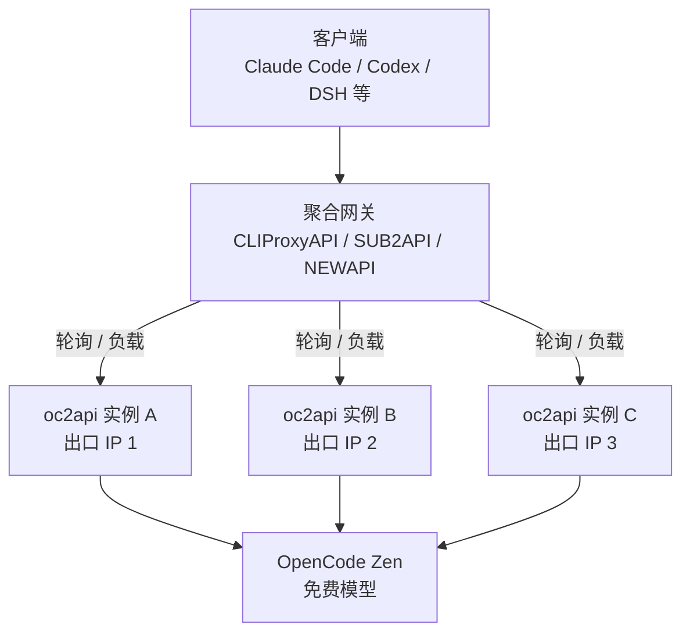

# oc2api

OpenCode Free API 代理，使用一套 Express 业务逻辑，同时支持本地运行、Docker 和 Vercel 部署，并支持 SSE 流式响应。

还想反代其它 AI？可以看 [codearts2api](https://github.com/zhuweiyou/codearts2api)：把十几种 AI 账号或订阅汇聚成 OpenAI 兼容接口。



## Vercel 部署

### 一键部署

[](https://vercel.com/new/clone?repository-url=https%3A%2F%2Fgithub.com%2Fzhuweiyou%2Foc2api&env=API_KEY%2CDEBUG&envDefaults=%7B%22API_KEY%22%3A%22sk-zhu%22%2C%22DEBUG%22%3A%22true%22%7D&envDescription=API_KEY%EF%BC%9AAPI%20%E5%AF%86%E9%92%A5%EF%BC%88%E7%95%99%E7%A9%BA%E5%88%99%E5%8C%BF%E5%90%8D%E8%AE%BF%E9%97%AE%EF%BC%89%EF%BC%9BDEBUG%EF%BC%9A%E8%AE%BE%E4%B8%BA%20true%20%E5%BC%80%E5%90%AF%E8%B0%83%E8%AF%95%E6%97%A5%E5%BF%97&envLink=https%3A%2F%2Fgithub.com%2Fzhuweiyou%2Foc2api%23vercel-%E9%83%A8%E7%BD%B2)

### 手动部署

1. Fork 本仓库到你的 GitHub
2. 打开 [Vercel Dashboard](https://vercel.com)，点击 **Add New > Project**
3. 选择你 Fork 的仓库，点击 **Import**
4. 在 **Environment Variables** 中添加：
   - `API_KEY` — API 密钥（留空则匿名访问）
   - `DEBUG` — 设为 `true` 开启调试日志（可选）
5. 点击 **Deploy**，等待部署完成

部署完成后会得到一个 `https://<项目名>.vercel.app` 的域名。

你可以 Fork 后部署多个 Vercel Project，在 [router-for-me/CLIProxyAPI](https://github.com/router-for-me/CLIProxyAPI)、[Wei-Shaw/sub2api](https://github.com/Wei-Shaw/sub2api)、[QuantumNous/new-api](https://github.com/QuantumNous/new-api) 等聚合网关中配置多个域名，实现轮询、负载分摊。多个项目不保证出口 IP 不同，需通过各实例的 `/ip` 核对；独立出口取决于实际部署。

## 本地运行

要求 Node.js 24 或更高版本。

```bash
npm install
npm start
```

默认监听 `http://localhost:8080`。也可以通过环境变量配置：

```bash
API_KEY=your-key DEBUG=true PORT=8080 npm start
```

可选的本地上游中继可以在 OC2API 转换响应前处理限流重试：

```sh
ZEN_API_BASE_URL=http://127.0.0.1:2082/v1 ZEN_CONNECT_TIMEOUT_MS=300000 npm start
```

- `ZEN_API_BASE_URL`：上游地址，默认 `https://opencode.ai/inference/v1`。免费层只认 `inference` 路径，所以填 `https://opencode.ai/zen/v1` 这类旧写法会被自动改写到 `/inference/v1`；其它主机（例如自建中继）原样使用
- `ZEN_CONNECT_TIMEOUT_MS`：收到响应头前的等待时间，默认 60000 毫秒，允许 1–600000；使用中继重试时应设置为大于其恢复窗口

同一段对话的每一轮会复用同一个上游 session，从而命中它的 prompt 缓存；换一段对话或换一个调用方则各自独立。调用方自己带的 `x-opencode-session` 会被沿用，也可以用 `x-session-affinity`、`X-Session-Id`、`conversation-id` 或请求体的 `prompt_cache_key` 指定会话。

健康检查：

```bash
curl http://localhost:8080/health
```

## Docker 部署

镜像定义与编排文件统一放在 `docker/` 目录下（根目录不放 Dockerfile，避免 Vercel 把项目误判为容器项目）：

```bash
cd docker && docker compose up -d --build
```

## API

兼容 OpenAI API 格式，路径均支持带 `/v1` 前缀或不带：

| 路径                                          | 方法 | 说明                                  |
| --------------------------------------------- | ---- | ------------------------------------- |
| `/v1/chat/completions` 或 `/chat/completions` | POST | Chat 补全（支持 `stream: true` 流式） |
| `/v1/models` 或 `/models`                     | GET  | 模型列表                              |
| `/` 或 `/health`                              | GET  | 健康检查                              |
| `/ip`                                         | GET  | 查询出口 IP                           |

配置 API Key 后，请求携带：

```text
Authorization: Bearer <api-key>
```

也支持 `X-API-Key`。

客户端工具、工具选择、历史工具调用和多轮工具结果回填均可正常使用，工具名与参数原样往返。

## 免费模型

代理仅放行免费模型（`big-pickle` 及所有以 `-free` 结尾的模型）。以下是常用且已验证可用的几个：

| 模型                       | 上下文  | 输出   | 图片输入 |
| -------------------------- | ------- | ------ | -------- |
| `big-pickle`               | 200,000 | 32,000 | ❌       |
| `mimo-v2.6-flash-free`     | 200,000 | 32,000 | ✅       |
| `deepseek-v4.1-flash-free` | 200,000 | 32,000 | ✅       |
| `glm-5.3-flash-free`       | 200,000 | 32,000 | ✅       |

- `context`：最大上下文窗口，单位 tokens
- `output`：最大单次输出长度，单位 tokens

以上数据来源于 [https://models.opencode.ai/api.json](https://models.opencode.ai/api.json)（`opencode` key 下对应模型的 `limit` 与 `modalities` 字段），可自行查看核实，以实际使用为准。

## 错误处理

上游返回 HTTP 错误时透出可判断的真实语义，不再一律归一成 `429`：只有上游真的限流才是 `429`（`rate_limit_error`），参数错误为 `400`（`invalid_request_error`），鉴权失败为 `401`/`403`（`authentication_error`），服务端问题为 `5xx`（`upstream_error`）。这样客户端能区分「额度用尽」和「请求写错了」，也便于把问题反馈给上游。流式响应头尚未发送前错误以普通 JSON 返回；头已发送后返回 SSE 错误事件且不补 `[DONE]`。oc2api 自身的流异常（缺少完成信号、上游误选保留工具）使用 `502`（`upstream_stream_error`）；建连网络失败、建连超时及模型列表错误使用 `502` / `504`。

上游误选代理内部保留工具时按错误结束，不会把它当成客户端同名工具交回客户端执行。

## 开发

```bash
npm test              # 离线测试，不访问上游；CI 只跑这个
npm run test:live     # 真实联调，需要网络，不进 CI
npm run lint          # ESLint 静态检查
npm run format:check  # 检查格式
npm run format        # Prettier 自动格式化
```

联调用例会对 `big-pickle`、`mimo-v2.6-flash-free`、`deepseek-v4.1-flash-free`、`glm-5.3-flash-free` 各跑一次多轮连续工具调用（含与内置同名的客户端 `read`），真实请求上游，受免费层限流影响；未设置 `OC2API_LIVE_TEST=1` 时自动跳过。因为依赖真实模型和上游配额，它不纳入 CI 门禁，需要时本地执行。
