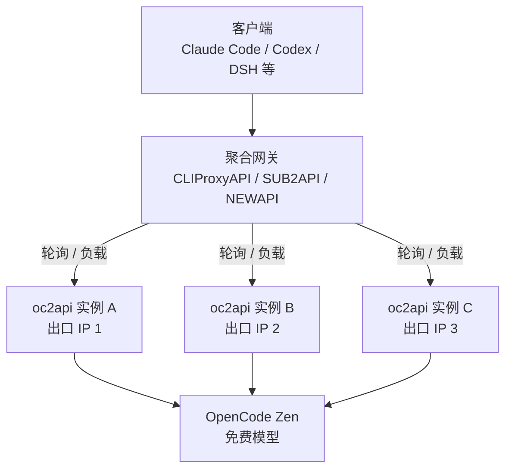

# oc2api

OpenCode 免费模型的 OpenAI 兼容代理，纯 Go 实现，支持 SSE 流式，可部署到 Vercel、Docker 或本地。



免费额度按出口网络计量。把多个实例填进 [router-for-me/CLIProxyAPI](https://github.com/router-for-me/CLIProxyAPI)、
[Wei-Shaw/sub2api](https://github.com/Wei-Shaw/sub2api)、[QuantumNous/new-api](https://github.com/QuantumNous/new-api)
做轮询，就能把额度摊到多个出口上。用每个实例的 `/ip` 核对出口是否真的不同。

## 部署方式

<details>
<summary><b>1. Vercel</b> — 一键部署，或导入仓库手动部署</summary>

<br>

**一键部署：**

[](https://vercel.com/new/clone?repository-url=https%3A%2F%2Fgithub.com%2Fzhuweiyou%2Foc2api&env=API_KEY%2CDEBUG&envDefaults=%7B%22API_KEY%22%3A%22sk-zhu%22%2C%22DEBUG%22%3A%22false%22%7D&envDescription=API_KEY%EF%BC%9AAPI%20%E5%AF%86%E9%92%A5%EF%BC%88%E7%95%99%E7%A9%BA%E5%88%99%E5%8C%BF%E5%90%8D%E8%AE%BF%E9%97%AE%EF%BC%89%EF%BC%9BDEBUG%EF%BC%9A%E8%AE%BE%E4%B8%BA%20true%20%E5%BC%80%E5%90%AF%E8%B0%83%E8%AF%95%E6%97%A5%E5%BF%97&envLink=https%3A%2F%2Fgithub.com%2Fzhuweiyou%2Foc2api%23vercel-%E9%83%A8%E7%BD%B2)

**手动部署：**

1. Fork 本仓库到你的 GitHub
2. 打开 [Vercel Dashboard](https://vercel.com)，点击 **Add New > Project**
3. 选择你 Fork 的仓库，点击 **Import**
4. 在 **Environment Variables** 中添加：
   - `API_KEY` — API 密钥（留空则匿名访问）
   - `DEBUG` — 设为 `true` 开启调试日志（可选）
5. 点击 **Deploy**，等待部署完成

部署完成后会得到一个 `https://<项目名>.vercel.app` 的域名。

构建阶段会自动下载 Go 工具链、编译出 linux 二进制并随函数打包（`scripts/build-go.sh`），
首次部署大概 1–2 分钟。Vercel 的 Go runtime 会缓冲整段响应，所以 Vercel 上的流式由
`api/index.js` 这层薄 Node 转发实现，业务逻辑仍然全在 Go 二进制里。

你也可以 Fork 后部署多个 Vercel Project 做轮询、负载分摊；多个项目不保证出口 IP 不同，
需通过各自实例的 `/ip` 核对。

</details>

<details>
<summary><b>2. Docker</b> — 云函数、容器平台或自建服务器</summary>

<br>

**直接拉取预构建镜像**

推送到 `main` 或推 `v*` 标签时，`Publish image` 工作流会自动构建 `linux/amd64` 与
`linux/arm64` 镜像，发布到 [`ghcr.io/zhuweiyou/oc2api`](https://github.com/zhuweiyou/oc2api/pkgs/container/oc2api)：

```bash
docker pull ghcr.io/zhuweiyou/oc2api:latest

docker run -d --name oc2api --restart unless-stopped \
  -p 8080:8080 \
  -e API_KEY=your-key \
  ghcr.io/zhuweiyou/oc2api:latest
```

| 触发方式               | 镜像标签                                                       |
| ---------------------- | -------------------------------------------------------------- |
| 推送到 `main`          | `latest`、`sha-<完整提交 SHA>`                                 |
| 推送版本标签 `v2.10.0` | `2.10.0`、`2.10`、`sha-<完整提交 SHA>`（`latest` 只跟 `main`） |
| Actions 页手动运行     | 当前分支或标签的 `sha-<完整提交 SHA>`                          |

首次发布后如需匿名拉取，在 **Packages → 镜像包 → Package settings** 把可见性设为 **Public**。

**本地构建**

镜像定义与编排文件在 `docker/`：

```bash
cd docker && docker compose up -d --build
```

镜像基于 `scratch`，容器内只有静态二进制和 CA 证书，监听 `PORT`（默认 `8080`）。
云函数环境建议把超时调到 300 秒，否则长回答的流式响应会被提前截断。

</details>

<details>
<summary><b>3. 本地运行（Go）</b> — 调试与临时使用</summary>

<br>

要求 Go 1.24 或更高版本。

```bash
go run ./cmd/oc2api                # 默认 :8080
API_KEY=your-key PORT=8080 go run ./cmd/oc2api
```

- `ZEN_API_BASE_URL`：上游地址，默认 `https://opencode.ai/inference`
- `ZEN_CONNECT_TIMEOUT_MS`：建连超时，默认 600000 毫秒
- `DEBUG`：设为 `true` 输出调试日志

健康检查：

```bash
curl http://localhost:8080/health
```

</details>

## API

兼容 OpenAI 格式，路径均支持带 `/v1` 前缀或不带：

| 路径                                          | 方法 | 说明                                  |
| --------------------------------------------- | ---- | ------------------------------------- |
| `/v1/chat/completions` 或 `/chat/completions` | POST | Chat 补全（支持 `stream: true` 流式） |
| `/v1/models` 或 `/models`                     | GET  | 模型列表                              |
| `/` 或 `/health`                              | GET  | 健康检查                              |
| `/ip`                                         | GET  | 查询出口 IP                           |

配置 API Key 后，请求携带：

```text
Authorization: Bearer <api-key>
```

也支持 `X-API-Key`。客户端工具、工具选择、多轮工具调用均可正常使用。

## 免费模型

代理只放行 `big-pickle` 及所有以 `-free` 结尾的模型，例如：

| 模型                       | 上下文  | 输出   | 图片输入 |
| -------------------------- | ------- | ------ | -------- |
| `big-pickle`               | 200,000 | 32,000 | ❌       |
| `mimo-v2.6-flash-free`     | 200,000 | 32,000 | ✅       |
| `deepseek-v4.1-flash-free` | 200,000 | 32,000 | ✅       |
| `glm-5.3-flash-free`       | 200,000 | 32,000 | ✅       |

数据来源 [https://models.opencode.ai/api.json](https://models.opencode.ai/api.json)，以实际为准。

### 免费额度

额度由上游按账号/网络计量，代理本身没有配额。用完时上游回 `429` 并带 `Retry-After`（秒），
到期自动恢复；oc2api 会把该头原样透给客户端。

| 状态 | 错误类型                                  | 含义                           |
| ---- | ----------------------------------------- | ------------------------------ |
| 403  | `FreeTierError`                           | 请求不像 OpenCode 客户端       |
| 429  | `FreeUsageLimitError`（带 `Retry-After`） | 额度用尽，或该出口已被上游限流 |

共享出口（云函数、Serverless）容易被别人先用掉额度，表现就是「昨天还好、今天全 429」，
这时换出口才有用。

## 开发

```bash
go test ./...              # 离线单元测试
go vet ./...
golangci-lint run ./...    # lint（配置见 .golangci.yml）
```

实现细节（为什么用 uTLS、免费层的形状要求、Vercel 为什么是薄 Node 层）见 [AGENTS.md](AGENTS.md)。
