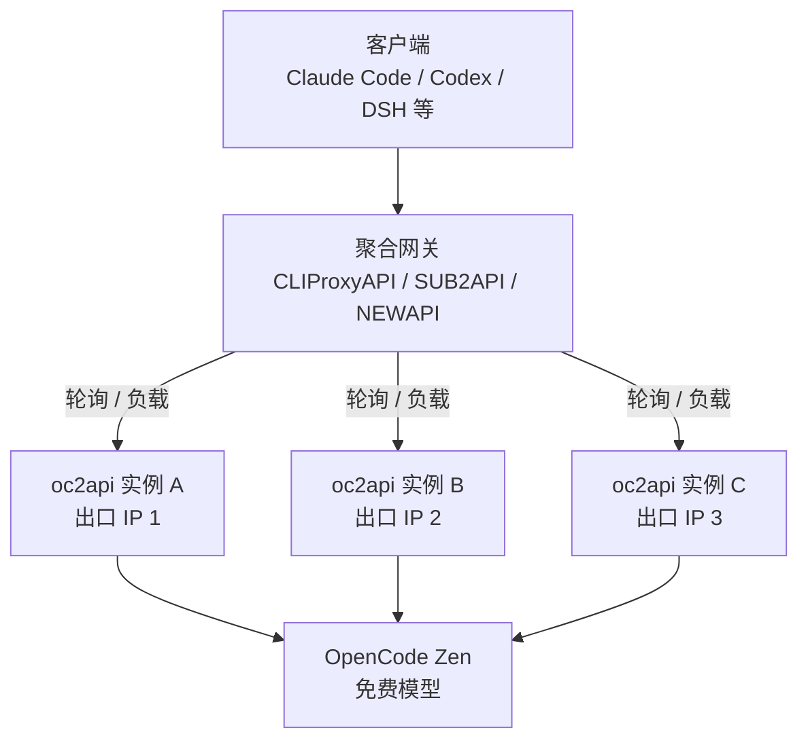

# oc2api

OpenCode 免费模型的 OpenAI 兼容代理，纯 Go 实现，支持 SSE 流式，可部署到 Vercel、Docker 或本地。



免费额度按出口网络计量。把多个实例填进 [router-for-me/CLIProxyAPI](https://github.com/router-for-me/CLIProxyAPI)、
[Wei-Shaw/sub2api](https://github.com/Wei-Shaw/sub2api)、[QuantumNous/new-api](https://github.com/QuantumNous/new-api)
做轮询，就能把额度摊到多个出口上。用每个实例的 `/ip` 核对出口是否真的不同。

## 部署方式

<details>
<summary><b>1. Vercel</b> — 一键部署，或导入仓库手动部署</summary>

<br>

**一键部署：**

[](https://vercel.com/new/clone?repository-url=https%3A%2F%2Fgithub.com%2Fzhuweiyou%2Foc2api&env=API_KEY%2CDEBUG&envDefaults=%7B%22API_KEY%22%3A%22sk-zhu%22%2C%22DEBUG%22%3A%22false%22%7D&envDescription=API_KEY%EF%BC%9AAPI%20%E5%AF%86%E9%92%A5%EF%BC%88%E7%95%99%E7%A9%BA%E5%88%99%E5%8C%BF%E5%90%8D%E8%AE%BF%E9%97%AE%EF%BC%89%EF%BC%9BDEBUG%EF%BC%9A%E8%AE%BE%E4%B8%BA%20true%20%E5%BC%80%E5%90%AF%E8%B0%83%E8%AF%95%E6%97%A5%E5%BF%97&envLink=https%3A%2F%2Fgithub.com%2Fzhuweiyou%2Foc2api%23vercel-%E9%83%A8%E7%BD%B2)

**手动部署：**

1. Fork 本仓库到你的 GitHub
2. 打开 [Vercel Dashboard](https://vercel.com)，点击 **Add New > Project**
3. 选择你 Fork 的仓库，点击 **Import**
4. 在 **Environment Variables** 中添加：
   - `API_KEY` — API 密钥（留空则匿名访问）
   - `DEBUG` — 设为 `true` 开启调试日志（可选）
5. 点击 **Deploy**，等待部署完成

部署完成后会得到一个 `https://<项目名>.vercel.app` 的域名。

构建阶段会自动下载 Go 工具链、编译出 linux 二进制并随函数打包（`scripts/build-go.sh`），
首次部署大概 1–2 分钟。Vercel 的 Go runtime 会缓冲整段响应，所以 Vercel 上的流式由
`api/index.js` 这层薄 Node 转发实现，业务逻辑仍然全在 Go 二进制里。

Vercel 版用 `-tags nomihomo` 构建，**不打包 mihomo 内核**（二进制约 8 MB），所以只能使用
纯文本 / URI / base64 里的 http、socks5 代理；Clash 多协议订阅需要 Docker 或本地版本。

你也可以 Fork 后部署多个 Vercel Project 做轮询、负载分摊；多个项目不保证出口 IP 不同，
需通过各自实例的 `/ip` 核对。

</details>

<details>
<summary><b>2. Docker</b> — 云函数、容器平台或自建服务器</summary>

<br>

**拉取镜像**

现成镜像在 [`ghcr.io/zhuweiyou/oc2api`](https://github.com/zhuweiyou/oc2api/pkgs/container/oc2api)：

```bash
docker pull ghcr.io/zhuweiyou/oc2api:latest

docker run -d --name oc2api --restart unless-stopped \
  -p 8080:8080 \
  -e API_KEY=your-key \
  ghcr.io/zhuweiyou/oc2api:latest
```

`latest` 跟着最新版本走；要固定版本就用具体的版本 tag。

容器监听 `PORT`，默认 `8080`。镜像基于 `scratch`，里面只有静态二进制和 CA 证书。
当前镜像带 mihomo 内核（约 47 MB）；想要轻量镜像可构建时加
`--build-arg GO_TAGS=nomihomo`（约 9 MB，仅 http/socks5）。
云函数环境建议把超时调到 300 秒，否则长回答的流式响应会被提前截断。

**本地构建**

镜像定义与编排文件在 `docker/`：

```bash
cd docker && docker compose up -d --build
```

</details>

<details>
<summary><b>3. 本地运行（Go）</b> — 调试与临时使用</summary>

<br>

要求 Go 1.24 或更高版本。

```bash
go run ./cmd/oc2api                # 默认 :8080
API_KEY=your-key PORT=8080 go run ./cmd/oc2api
```

- `PORT`：监听端口，默认 `8080`
- `API_KEY`：请求鉴权，留空则匿名
- `ZEN_API_BASE_URL`：上游站点根地址，默认 `https://opencode.ai`；接口路径由程序拼接，
  自建中继只填根地址即可
- `ZEN_CONNECT_TIMEOUT_MS`：建连、TLS 握手与等响应头的超时，默认 `60000`，允许 `1`–`600000`
- `DEBUG`：设为 `true` 输出调试日志
- 代理订阅相关环境变量（`PROXY_*`）见下方「[代理订阅与节点池](#代理订阅与节点池)」。

健康检查：

```bash
curl http://localhost:8080/health
```

</details>

## 代理订阅与节点池

**Docker 部署和本地运行都适用**：这两种构建内置 mihomo 内核，可以把一个代理订阅转成程序内的节点池——
**启动时即拉取订阅并开始健康探测**，之后按 `PROXY_STRATEGY` 选节点（默认 `sticky` 固定一个用到不可用，
`round_robin` 则每次轮询），并定时刷新订阅、失败自动换下一个。

订阅格式不限于 Clash：支持 Clash / Mihomo 的 YAML（`proxies:`）、纯文本 `IP:PORT[:USER:PASS]`、
`http://` / `socks5://` 等 URI 行、base64 包裹；其中 Clash YAML 的多协议节点
（ss / vmess / vless / trojan / hysteria2 等）由内置 mihomo 解析并拨号。
Vercel 函数版为了控制包体积不含内核，限制见本节末尾「构建变体」。

### 环境变量

| 变量 | 默认 | 说明 |
| --- | --- | --- |
| `PROXY_SUBSCRIPTION_URL` | 空（直连） | 订阅地址（http/https）。支持 Clash/Mihomo YAML（`proxies:`）、纯文本 `IP:PORT[(:USER:PASS)]`、`http://` / `socks5://` URI 行、base64 包裹；Clash YAML 里的多协议节点（ss / vmess / vless / trojan / hysteria2 等）由内置 mihomo 解析，带 `dialer-proxy` 的链式节点会跳过。 |
| `PROXY_MAX_ATTEMPTS` | `5` | 遇到 429/403/5xx 或节点不通时最多尝试几个节点，允许 `1`–`10` |
| `PROXY_STRATEGY` | `sticky` | 节点选择策略：`sticky`（填充，默认）——一个节点一直用到不可用（429/403/传输失败）才换下一个；`round_robin`——每次请求都轮询下一个健康节点 |
| `PROXY_HEALTH_INTERVAL_SECONDS` | `600` | 定时健康检查间隔秒数，允许 `60`–`86400`；`0` 关闭。定时检查会重试所有死节点，并每 30 分钟复检健康节点 |
| `PROXY_SUBSCRIPTION_REFRESH_SECONDS` | `1800` | 定时重新拉取订阅的间隔，允许 `300`–`86400`；`0` 关闭。只有拉取成功、解析出节点、且新节点探测后至少有一个健康节点才替换；失败/为空/全不健康都会**保留旧节点池**，未变节点保留健康与冷却状态 |

Docker 示例：

```bash
docker run -d --name oc2api --restart unless-stopped \
  -p 8080:8080 \
  -e API_KEY=your-key \
  -e PROXY_SUBSCRIPTION_URL='https://你的订阅地址' \
  ghcr.io/zhuweiyou/oc2api:latest
```

### 运行行为

- 加载后后台并发探测节点（真实 TLS 握手，不消耗上游额度），只把健康节点投入轮换；
- 默认每 30 分钟重新拉取订阅；**新节点先在旧池之外探测完，再整体切换**，刷新期间旧节点一直可用；
  拉取失败、解析为空、或新池探测后没有健康节点时完整保留旧节点池；未变节点按稳定 key 保留健康/冷却状态；
- 默认 `sticky` 填充：固定用一个健康节点，直到它 429/403/传输失败才换下一个；`round_robin` 则每次请求轮询下一个；
- 每个请求新建连接；429/403/5xx 或节点不通时自动切换；
- `GET /ip` 同时返回 `{"direct": {...}, "proxy": {...}}`：直连出口与节点池出口各一份，
  proxy 那份带实际节点名。每个出口由 `api.ipquery.io`、`ip-api.com`、`1.1.1.1/cdn-cgi/trace`
  三个来源并发竞速，**谁先返回有效 IP 用谁**；trace 命中时额外返回 `warp/loc/colo`。
- `GET /health` 返回 `proxy.total / healthy / cooling / unknown`，并默认附带**健康节点列表**
  （`proxy.nodes`）；可用 `?state=healthy|unhealthy|cooling|all` 切换。节点名不算敏感信息，公开可见；
  Vercel 无内核构建只返回统计，不返回节点列表。

### 构建变体（内核体积）

| 构建 | 命令 | 二进制约 | 订阅能力 |
| --- | --- | --- | --- |
| 无内核（Vercel） | `go build -tags nomihomo ...` | **8.4 MB** | 仅 http/socks5（纯文本、URI、base64）；Clash 多协议不可用 |
| 带内核（本地 / Docker） | 不加 tag | **46.4 MB** | Clash YAML 全协议：ss/vmess/vless/trojan/hysteria2 等 |

- Vercel 的 `scripts/build-go.sh` 固定加 `-tags nomihomo`；
- Docker 默认带内核；想要瘦身镜像可 `docker build --build-arg GO_TAGS=nomihomo ...`；
- 本地 `go run ./cmd/oc2api` 默认带内核。

## API

兼容 OpenAI 格式，路径均支持带 `/v1` 前缀或不带：

| 路径                                          | 方法 | 说明                                  |
| --------------------------------------------- | ---- | ------------------------------------- |
| `/v1/chat/completions` 或 `/chat/completions` | POST | Chat 补全（支持 `stream: true` 流式） |
| `/v1/models` 或 `/models`                     | GET  | 模型列表                              |
| `/` 或 `/health`                              | GET  | 健康检查（带订阅池时含健康节点列表）  |
| `/ip`                                         | GET  | 同时查询直连与节点池出口 IP（多来源竞速） |

配置 API Key 后，请求携带：

```text
Authorization: Bearer <api-key>
```

也支持 `X-API-Key`。客户端工具、工具选择、多轮工具调用均可正常使用。

## 免费模型

代理只放行 `big-pickle` 及所有以 `-free` 结尾的模型，例如：

| 模型                       | 上下文  | 输出   | 图片输入 |
| -------------------------- | ------- | ------ | -------- |
| `big-pickle`               | 200,000 | 32,000 | ❌       |
| `mimo-v2.6-flash-free`     | 200,000 | 32,000 | ✅       |
| `deepseek-v4.1-flash-free` | 200,000 | 32,000 | ✅       |
| `glm-5.3-flash-free`       | 200,000 | 32,000 | ✅       |

数据来源 [https://models.opencode.ai/api.json](https://models.opencode.ai/api.json)，以实际为准。

### 免费额度

额度由上游按账号/网络计量，代理本身没有配额。用完时上游回 `429` 并带 `Retry-After`（秒），
到期自动恢复；oc2api 会把该头原样透给客户端。

| 状态 | 错误类型                                  | 含义                           |
| ---- | ----------------------------------------- | ------------------------------ |
| 403  | `FreeTierError`                           | 请求不像 OpenCode 客户端       |
| 429  | `FreeUsageLimitError`（带 `Retry-After`） | 额度用尽，或该出口已被上游限流 |

共享出口（云函数、Serverless）容易被别人先用掉额度，表现就是「昨天还好、今天全 429」，
这时换出口才有用。

## 开发

```bash
go test ./...                     # 离线单元测试
go test -tags nomihomo ./...      # 无内核构建（Vercel 用）也要过
go vet ./...
golangci-lint run ./...           # lint（配置见 .golangci.yml）
CGO_ENABLED=0 GOOS=linux GOARCH=amd64 go build -tags nomihomo ./cmd/oc2api  # ~8MB
CGO_ENABLED=0 GOOS=linux GOARCH=amd64 go build ./cmd/oc2api                 # ~46MB，带内核
```

实现细节（为什么用 uTLS、免费层的形状要求、Vercel 为什么是薄 Node 层）见 [AGENTS.md](AGENTS.md)。
