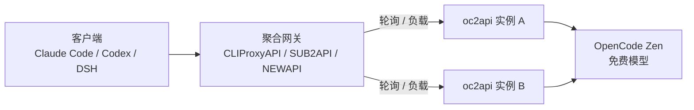

# oc2api

OpenCode 免费模型的 OpenAI 兼容代理。纯 Go 实现，可在本地、Docker、Vercel 上跑，支持 SSE 流式。



## 为什么是 Go

免费层现在按**传输层指纹**识别客户端：Node、curl、Cloudflare 的 TLS 握手都会被判定成"非 OpenCode 流量"并返回 `429 FreeUsageLimitError`，只有 Bun（OpenCode 官方客户端的运行时）能过。Go 用 `refraction-networking/utls` 复刻 Bun 的 ClientHello（JA4 `t13d1713h1`），配合官方 system 提示词、官方工具集、`max_completion_tokens` 和 `ses_` 会话 id，才能稳定拿到 200。

## 部署

### 本地

```bash
go run ./cmd/oc2api           # 默认 :8080，可用 PORT 覆盖
API_KEY=your-key go run ./cmd/oc2api
```

### Docker

```bash
cd docker && docker compose up -d --build
```

镜像分两阶段：`golang:1.24-alpine` 编译静态二进制，`distroless/static` 运行，没有 Node 和依赖树。

### Vercel

Vercel 的 Go runtime 会缓冲整段响应，SSE 出不来，所以走"薄 Node + Go 二进制"：

- `scripts/build-go.sh`：构建期下载 Go 工具链、交叉编译 `linux/amd64` 二进制到 `bin/`；
- `api/index.js`：首次请求 `spawn` 二进制（`-stdio`）并常驻，用带 `id` 的 JSON-RPC 分发并发请求，只做路由、鉴权和 SSE 翻译；
- 业务逻辑全在 Go，Node 侧没有任何上游逻辑。

```bash
vercel --prod
```

需要配置环境变量 `API_KEY`（留空则匿名访问）。

### 多出口

免费额度按网络计量，一个出口用光就换下一个：

```bash
curl https://<实例>/ip   # 核对出口 IP
```

把多个实例填进 [router-for-me/CLIProxyAPI](https://github.com/router-for-me/CLIProxyAPI)、[Wei-Shaw/sub2api](https://github.com/Wei-Shaw/sub2api)、[QuantumNous/new-api](https://github.com/QuantumNous/new-api) 做轮询。

## API

| 路径                                          | 方法 | 说明                                  |
| --------------------------------------------- | ---- | ------------------------------------- |
| `/v1/chat/completions` 或 `/chat/completions` | POST | Chat 补全（支持 `stream: true` 流式） |
| `/v1/models` 或 `/models`                     | GET  | 模型列表                              |
| `/` 或 `/health`                              | GET  | 健康检查                              |
| `/ip`                                         | GET  | 查询出口 IP                           |

配置 `API_KEY` 后，请求携带 `Authorization: Bearer <api-key>` 或 `X-API-Key`；留空则匿名。

## 免费模型

代理只放行 `big-pickle` 和所有以 `-free` 结尾的模型，列表来自 `https://models.opencode.ai/api.json` 对应的上游 `/v1/models`。

### 免费额度与错误语义

额度由上游按账号/网络计量，代理本身没有配额：

| 状态 | 错误类型                                  | 含义                                                            |
| ---- | ----------------------------------------- | --------------------------------------------------------------- |
| 403  | `FreeTierError`                           | 请求不像 OpenCode 客户端（缺官方工具集、`ses_` 会话 id 不合法） |
| 429  | `FreeUsageLimitError`（带 `Retry-After`） | 形状已通过校验，但账号 / 网络当天的免费额度用完了               |

`Retry-After` 会原样透给客户端（并通过 CORS 暴露）。共享出口（云函数、Serverless）容易被别人先用掉额度，表现就是"昨天还好、今天全 429"。

## 配置

| 变量                     | 说明                                               |
| ------------------------ | -------------------------------------------------- |
| `API_KEY`                | 本服务鉴权密钥，留空则匿名                         |
| `PORT`                   | 本地/Docker 监听端口，默认 `8080`                  |
| `DEBUG`                  | 设为 `true` 输出调试日志                           |
| `ZEN_API_BASE_URL`       | 覆盖上游地址，默认 `https://opencode.ai/inference` |
| `OC2API_WORKDIR`         | 注入提示词里的工作目录，默认 `/workspace`          |
| `ZEN_CONNECT_TIMEOUT_MS` | 建连超时，默认 600000 毫秒                         |

## 工具处理

免费层要求请求带上官方工具集（去掉 `tools` 直接 429），但客户端并没有这些工具：

- 客户端声明的每个工具改名 `clint_<name>`，响应里再还原；
- 官方工具的描述统一改成"Reserved for the host runtime; do not call..."，降低被选中的概率；
- 客户端没声明任何工具时，system 末尾再补一句"不要调用工具"；
- 响应侧按 `index` 缓冲工具调用，确认不是客户端声明的就整条丢弃，`finish_reason` 从 `tool_calls` 回退成 `stop`；
- 非流式如果因此没有正文，带更强提示重试一次。

## 开发

```bash
go test ./...      # 单元测试（离线）
go vet ./...       # 静态检查
gofmt -l .         # 格式检查
go build ./cmd/oc2api
```

包职责：

| 包                  | 职责                                               |
| ------------------- | -------------------------------------------------- |
| `internal/config`   | 环境变量与版本号                                   |
| `internal/zen`      | uTLS 传输、上游请求、会话 id、模型列表             |
| `internal/shape`    | 系统提示词与工具整形（`clint_` 改名、32k 上限）    |
| `internal/chat`     | 串起整形与上游调用，非流式聚合 + 兜底重试          |
| `internal/protocol` | SSE 解析、聚合、错误语义、内置工具过滤             |
| `internal/httpapi`  | 本地/Docker 的 HTTP 入口                           |
| `internal/rpc`      | JSON-RPC（HTTP 与 stdio 两种载体）                 |
| `api/index.js`      | Vercel 薄层：路由、鉴权、SSE 翻译、spawn Go 二进制 |
